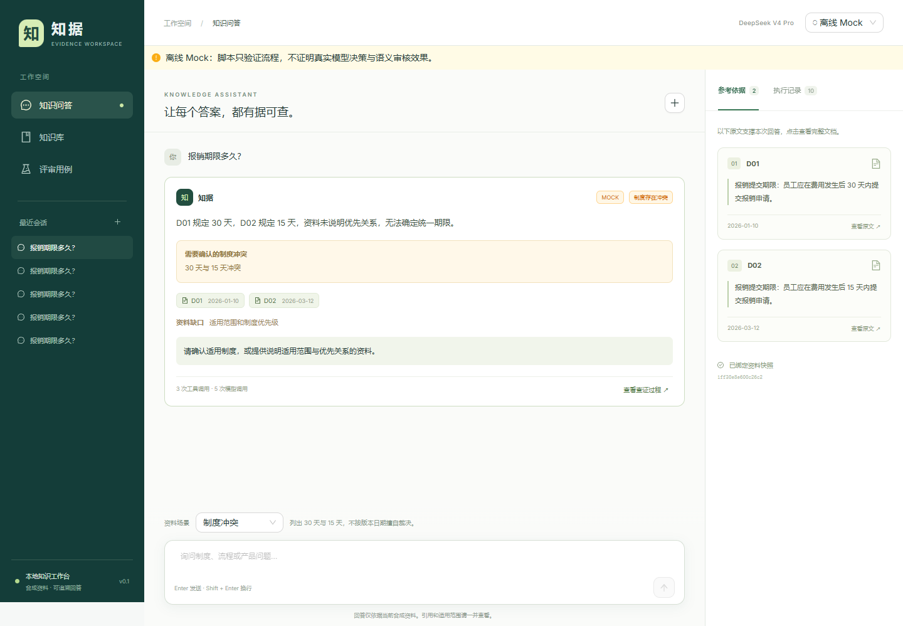

# 知据 · 企业知识问答 Agent

让企业制度与产品问答有原文依据。基于 **DeepSeek V4 Pro + LangGraph + FastAPI + React**，模型根据检索结果选择补充检索、读取原文、追问或停止。冲突不擅自裁决，工具失败和资料不足分别报告。

仓库：https://github.com/xiaoqifabaowa/xiaoying

题目名称：企业知识问答 Agent。原题未标注数字题号，提交时需由出题方确认。最终 commit SHA 请使用 `git rev-parse HEAD`，以最终交付消息为准。



截图为明确标识的 Mock 界面测试；**真实模型运行证据位于 [examples/live](examples/live/report.json)**，两者不混用。

## 快速评审

1. 查看 [需求](docs/01-requirements.md)、[方案](docs/02-solution.md)、[评估](docs/03-evaluation.md)。
2. 对照真实模型 [正常路径](examples/live/normal/trace.jsonl)、[冲突路径](examples/live/conflict/trace.jsonl)、[补充检索路径](examples/live/outside/trace.jsonl)、[工具失败路径](examples/live/search_failure/trace.jsonl)。
3. 查看 [D01 改为 45 天后的实际结果](examples/live/changed/output.json)，与正常场景 30 天结果比较。
4. 本地启动后，进入“评审用例”，选择真实模型或离线 Mock 重放。页面“预期”不是测试通过结论。

## 环境与安装

- Python 3.12（实际验证 3.12.4）。
- Node.js 22.12+；实际验证 Node 25.2.1。
- Windows PowerShell 可运行启动脚本；macOS/Linux 使用下面的手动命令。
- 真实模型需要 DeepSeek API 密钥和网络；离线 Mock 无须模型密钥。首次安装依赖需要网络。

Windows 一键安装和启动：

```powershell
./start.ps1 -Install
```

后续启动：

```powershell
./start.ps1
```

手动安装（Windows 将 `.venv/bin/python` 替换为 `.venv/Scripts/python.exe`）：

```bash
python -m venv .venv
.venv/bin/python -m pip install -r requirements.lock.txt
.venv/bin/python -m pip install --no-deps -e .
cd frontend
npm ci
npm run build
cd ..
.venv/bin/python -m uvicorn enterprise_qa.api:app --host 127.0.0.1 --port 8000
```

浏览器打开 **http://127.0.0.1:8000**，接口文档在 **http://127.0.0.1:8000/docs**。本项目是单进程、本机评审服务；不要用多 worker 模式运行，也不提供公网身份认证。

前端开发：先运行后端，再执行 `cd frontend && npm run dev`，Vite 将 `/api` 代理到本地 8000 端口。

## 模型配置

复制 `.env.example` 为 `.env`，仅在本地填写 `DEEPSEEK_API_KEY`。默认：

```dotenv
DEEPSEEK_BASE_URL=https://api.deepseek.com
DEEPSEEK_MODEL=deepseek-v4-pro
MAX_STEPS=8
MAX_TOOL_CALLS=10
RUN_TIMEOUT_SECONDS=90
MODEL_TIMEOUT_SECONDS=40
TOOL_TIMEOUT_SECONDS=10
```

配置变更后重启服务。密钥仅由后端使用，`.env` 已被 Git 忽略；不要将密钥加入源码、截图或提交消息。API 调用失败返回明确状态，不自动降级 Mock。真实模型重放会调用你的 DeepSeek 配额。

模型通过官方 Chat Completions 接口，以 JSON 动作协议自主选择本地工具；未使用供应商 `tool_calls` 消息协议。两者不影响“模型选择动作 → 执行工具 → 观察 → 再决策”的实质循环。使用非思考模式，Trace 只记录简短行动依据，不采集内部思维过程。

## 命令行与验证

以下命令使用已安装项目的 Python；Windows 可用 `.venv/Scripts/python.exe` 替代 `python`。

```bash
# 无密钥演示
python -m enterprise_qa.cli --mode mock --scenario conflict --output runtime/demo

# 真实模型、合成资料
python -m enterprise_qa.cli --mode live --scenario conflict --output runtime/live-demo

# 后端可执行测试
python -m pytest -q --junitxml=examples/test-results/pytest.xml

# 重跑全部离线场景
python scripts/evaluate.py --mode mock --force

# 重跑全部真实模型场景（会调用付费 API）
python scripts/evaluate.py --mode live --force

# 启动后端后运行浏览器测试
cd frontend
npm run test:e2e
```

评估脚本不加 `--force` 时会复核已有输出，而不是重新调用模型。每个样例保存 `input.json`、`output.json`、`snapshot.json` 和 `trace.jsonl`；上下文样例另外保存 `prelude.json`。

浏览器测试默认使用本机 Edge。其他环境可执行 `npx playwright install chromium`，设置 `PLAYWRIGHT_CHANNEL=chromium` 后运行。GitHub Actions 只运行离线测试、前端构建及 Chromium UI 测试，不需要密钥。

## 主要功能

- 模型自主调用搜索、读取工具，并根据观察修正动作。
- 本地中文 BM25 + 字符二元组检索；无须向量数据库和 Embedding 下载。
- 原文片段、文档 ID、版本及知识库快照绑定。
- 机械引用校验 + 真实模型语义审核；未通过候选答案不发布。
- 制度冲突说明、范围缺口追问、多轮会话、故障处理及预算上限。
- SSE 实时动作记录、Trace 下载、SQLite 会话持久化、重启中断恢复。
- 三页前端：知识问答、知识库、评审用例；手机尺寸可查看引用与执行记录。
- 离线 Mock 使用同一执行器，但不证明语义正确或真实模型决策能力。

## 项目结构

```text
src/enterprise_qa/   后端、模型适配、Agent、检索、证据与存储
frontend/           React + TypeScript + Ant Design 工作台
data/               合成资料、验收场景和故障注入配置
tests/              后端单元及接口测试
frontend/tests/     Playwright 浏览器测试
scripts/evaluate.py 实际运行材料生成与断言评估
examples/           真实/Mock 输入输出、快照、Trace、测试报告和截图
docs/               题目要求的五份设计与验证文档
runtime/            本地数据库与缓存（不提交）
```

## 已知边界

这是小规模合成资料上的可复现实现，不是企业生产知识平台。未实现登录权限、PDF/OCR、上传后台、分布式任务恢复或向量检索。当前语义审核由同一模型承担，可能共享判断偏差；自动测试通过不等于任意企业问题均正确。资料未命中不代表现实中不存在规定。详细限制见 [评估文档](docs/03-evaluation.md)。
