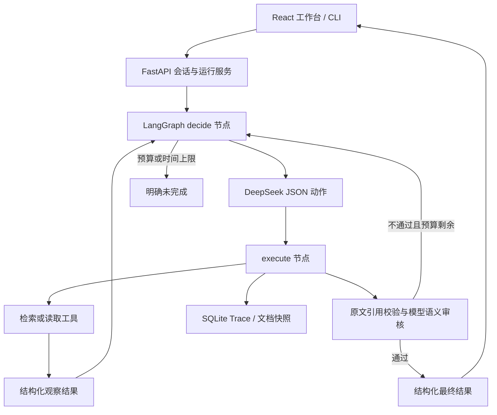

# 02 · 方案、动态决策与取舍

## 调用流程

每个请求构造独立 Agent 状态：question、history、evidence、observations、steps、tools、decision、result。图结构预设，但搜索内容、读哪份文档、何时追问或结束由真实模型依据观察决定。执行器不按题目关键字选择真实模型动作。

`search_documents(query,top_k)` 和 `read_document(doc_id)` 是两个业务工具；`finish`、`ask_user` 是终止动作。JSON Schema 约束输出，通过官方 Chat Completions 的 JSON 模式接入，不依赖原生 tool_calls。无效 JSON、参数或引用会作为校验观察返回模型，修正仍计入预算。

`steps` 包含决策调用和语义审核调用，默认最多 8；工具最多 10 次；单工具 10 秒、模型请求 40 秒、整次运行 90 秒。达到任一上限，返回 incomplete。重启会将数据库中的 queued/running 标记为 SERVER_RESTART，不虚构自动续跑。

## 框架职责与实际版本

- Python 3.12.4；FastAPI 0.162.0：路由、请求校验、OpenAPI、SSE 响应。
- Pydantic 2.14.1：动作、引用、结果、参数 schema 与边界。
- LangGraph 1.2.18：StateGraph、条件边、异步 values 流。未使用其 checkpoint、长期记忆或托管平台。
- HTTPX 0.28.1：模型网络请求和显式超时；错误日志不保存请求头或供应商错误正文。
- jieba 0.42.1 + rank-bm25 0.2.2：中文分词和相关性排序。
- React 19.3.1 / TypeScript 5.9.3：组件与类型；Ant Design 5.29.3：控件；Vite 7.3.7：构建。以 `frontend/package-lock.json` 为准。
- pytest 9.2.0：后端验证；Playwright 1.64.1：浏览器端到端验证。

后端传递依赖完整锁定在 `requirements.lock.txt`。未重新实现上述框架。

## 检索与文档版本

使用分词与字符二元组构造 BM25 词项，并用词项重叠补偿极小语料的 IDF 边界。候选排序使用非负 BM25 分数 + 查询词项覆盖比例。单词短查询允许一个词项命中，其余至少两个词项命中；这是小语料可解释启发式，不是通用语义召回保证。

每份文档按段落建立片段，保留文本起止位置。整个资料集计算内容摘要作为 dataset_version；运行开始后持有独立快照，SQLite 保存原文。历史引用通过快照读取，不会被后续文档替换污染。

基础检索不含 Embedding。语义改写主要依靠模型生成新的搜索词；当前真实 outside 路径展示了无结果后的补充检索。大规模语料上的召回质量尚未评估。

## 证据与冲突

机械校验检查：已成功读取、ID 与版本匹配、片段存在、引用为连续原文、引用索引有效、确定回答具有结论/引用、冲突具有多文档证据。

语义审核接收问题、历史、候选结果、全部已读证据及工具观察。它检查适用范围、原文支持和已知冲突。工具错误本身是故障陈述的证据，不能要求企业制度来证明接口异常。

D01=30 天、D02=15 天且没有适用范围/优先规则时，不能选择较新 D02。模型可补充检索相关范围；原文已经明确缺失范围时也可列出双方后追问，不强制额外无意义工具调用。用户口头倾向不是权威制度证据。

语义审核仍可能误判，特别是审核与生成使用同一个模型。不能将机械引用通过或模型审核通过当作绝对正确证明。

## API、持久化与前端

接口定义在 `/docs`。创建会话、提交运行、查询运行、SSE 事件、Trace 下载、资料场景、文档原文均有独立接口。SSE 支持 after/Last-Event-ID 续读；关闭浏览器不取消后端运行。

SQLite 表：conversations、runs、events、snapshots。一个会话只允许一个活跃运行，使用唯一索引防并发交错；历史取最近 6 次已结束运行，用于理解追问而非证据。历史 UI 可重新加载未结束任务。

前端为知识问答、知识库、评审用例三页。最终回答审核后一次性发布，事件流只提前展示动作。引用打开绑定版本的原文抽屉，手机端也可查看引用与执行记录。

## 安全与边界

默认绑定 127.0.0.1；没有公网认证。工具只访问内存合成文档，不接受任意文件路径或 URL。文档及历史按不可信数据进入提示词，不能改变工具白名单。密钥仅在后端配置中，前端只获知是否配置。日志不包含密钥、供应商请求头或内部推理。

Mock 的关键词分支是显式演示实现，只验证执行器、页面与错误协议；真实模式从不调用它。故障注入是题目允许的本地业务工具 Mock，真实失败样例中模型仍实际调用 DeepSeek。
